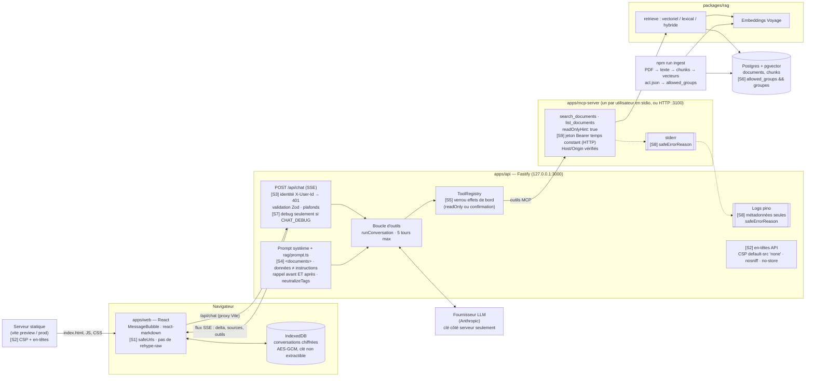

# Architecture du chatbot, et où s'applique chaque contrôle de sécurité

> Les risques, corrections et preuves : [`security/SECURITE.md`](../security/SECURITE.md).
> Le cours : [Jour 5 — La sécurité](cours/jour-5-securite.md).

## Vue d'ensemble

Les pastilles **[S1]** à **[S9]** renvoient au tableau des contrôles, sous le schéma.

## Le trajet d'une question, contrôle par contrôle

1. Le navigateur charge la page : **[S2]** la CSP dit ce qu'elle a le droit
   d'exécuter et de contacter.
2. L'utilisateur envoie un message : `/api/chat` l'identifie **[S3]** avant
   toute autre chose, valide le corps, ignore `debug` si le serveur ne
   l'autorise pas **[S7]**.
3. Le modèle reçoit un prompt système sans secret, et décide de chercher.
4. `search_documents` (serveur MCP, lecture seule) interroge Postgres **[S6]** :
   le filtre de groupes est dans le `WHERE`, avant le classement. Le prompt
   n'y est pour rien : un document hors droits n'arrive jamais au modèle.
5. Les extraits reviennent encadrés comme des **données** **[S4]**.
6. Si le modèle, influencé par un extrait, demande une action, le registre
   la refuse sans confirmation **[S5]**.
7. La réponse repart en SSE ; le navigateur la rend sans HTML brut, sans
   image ni lien vers une origine inconnue **[S1]**, sous la CSP **[S2]**.
8. Tout au long, les logs ne gardent que des métadonnées **[S8]**.

## Les contrôles

| Pastille | Contrôle | Où | Risque OWASP LLM 2025 | Ce qu'il garantit | Dépend du modèle ? |
| --- | --- | --- | --- | --- | --- |
| S1 | Rendu sûr : pas de `rehype-raw`, `urlTransform`, composants `img` / `a` en liste blanche | `apps/web/src/chat/safeUrls.ts`, `MessageBubble.tsx` | LLM05 | Le DOM ne contient ni balise vivante, ni image distante, ni lien vers une origine inconnue | non |
| S2 | CSP stricte (sans `'unsafe-inline'`) + en-têtes | `apps/web/vite.config.ts` (page), `apps/api/src/server.ts` (API) | LLM05 | Même si du HTML passait S1 : ni script inline, ni requête vers une autre origine | non |
| S3 | Identité avant tout, schéma Zod, plafonds | `apps/api/src/routes/chat.ts` | LLM10 (en partie) | Pas d'appel modèle sans utilisateur connu ; taille bornée | non — mais l'identité est **falsifiable** (exercice) |
| S4 | Documents comme données : message utilisateur / résultat d'outil, balises neutralisées, consigne avant et après | `apps/api/src/rag/prompt.ts`, `chat/search-results.ts` | LLM01 | Réduit la probabilité qu'un document soit pris pour une instruction | **oui** |
| S5 | Verrou sur les effets de bord | `apps/api/src/tools/registry.ts` | LLM01, LLM06 | Aucune action sans confirmation humaine, même si le modèle obéit au document | non |
| S6 | Droits par groupe dans le SQL | `packages/rag/src/db/repository.ts` | LLM02, LLM08 | Un document hors droits n'atteint jamais le modèle | non |
| S7 | `debug` autorisé par le serveur seulement | `apps/api/src/config.ts`, `routes/chat.ts` | LLM07 | Le client ne peut pas obtenir le prompt système par un paramètre | non |
| S8 | Logs de métadonnées, erreurs sans texte cité | `packages/rag/src/errors.ts` + tous les logs | LLM02 | Ni question, ni réponse, ni document, ni jeton, ni groupe dans les journaux | non |
| S9 | Serveur MCP HTTP : jeton par requête en temps constant, session liée au jeton, Host/Origin | `apps/mcp-server/src/auth.ts`, `transports/http.ts` | LLM06 | Un tiers ne parle pas au serveur MCP au nom d'un utilisateur | non |
| — | Mémoire locale chiffrée | `apps/web/src/storage/` | LLM02 | Historique illisible hors de l'origine (voir `docs/securite/memoire-locale.md`) | non |

La colonne « Dépend du modèle ? » est la plus importante : un seul contrôle
(S4) repose sur le comportement du modèle. C'est pourquoi il est doublé par
des contrôles déterministes en aval (S5 pour les actions, S1 et S2 pour la
sortie).
